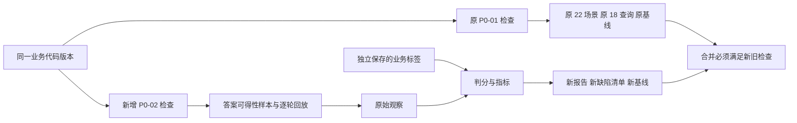

# P0-02 无答案与部分答案评测详细实施计划

版本：设计草案 1.1（已完成独立复核）。日期：2026-10-04。代码审查基准：`31b93e97d9f5455599ccb0e6334d89ddccbb8469`。

本方案落实[总体路线图](implementation-roadmap-2026-10-04.md)中的 P0-02，依赖已经完成的 [P0-01](p0-01-implementation-acceptance.md)。本次只完成设计与计划核对，没有开发以下拟新增模块，也没有确认新增业务标签或开展真实模型实验。

核心决定：建立独立的答案可得性评测模块，让旧检查和新检查并行。生产业务架构保持现状，P0-01 已接纳的报告、评分口径和基线继续有效。预计开发与工程验收约 7–9 人日，业务评审等待时间另计；这比原路线图的 2–4 人日粗估增加了真实入口逐轮观测、独立可信基线和远端接纳工作。

## 1 用产品语言说明本阶段

P0-01 给项目建立了一套可以重复检查的考卷。P0-02 要改进新考卷的出题与判分方式：不能假设所有客户问题都能从现有资料里找到答案。

| 客户问题与资料情况 | 合理表现 | 新评测要识别的问题 |
| --- | --- | --- |
| 资料明确写了接送范围，客户只问接送范围 | 准确回答，并保留适用条件 | 明明能回答却只说“请咨询人工” |
| 接送范围已知，儿童价格未知 | 回答接送范围，说明儿童价格尚需核实 | 把整条问题都拒绝，或补造儿童价格 |
| 只有酒店介绍，没有指定日期的房态 | 说明目前不能确认，并提出下一步核实方式 | 把“有这家酒店”说成“当天有房” |
| 两份有效资料对取消条件说法冲突 | 指出需要核实的具体部分 | 随意选一条说成确定政策 |
| 仅有已过期的促销价 | 可说明它是历史信息，不能当作当前报价 | 沿用旧价作当前承诺 |

这些是拟采用的验收要求，不是已经实现的产品行为。P0-02 建立衡量这些行为的能力，并暴露现有问题。让线上助手自动落实回答范围与承诺限制，主要由 P0-05 实施；生产资料有效期和实时供应治理由 P1-02 实施。

新增功能是三态标签、按答案要点评分、无依据作答与不必要拒答统计、逐轮检查，以及独立的中文对照报告。调整的是新评测的分母和失败归因。现有线索评分、报价计算、数据库结构、CRM 同步流程、客户工作台不在本阶段改动范围。

## 2 当前代码事实与设计依据

以下结论来自本轮代码与数据读取，不是待开发能力。

| 现状 | 位置 | 设计影响 |
| --- | --- | --- |
| 每题必须有 grade-3 直接答案，所有 facet 必须被直接答案覆盖 | [eval_schemas.py](../src/lead_cleaner/rag/eval_schemas.py)，75–88 行 | 现有契约不能表达完全无答案或部分可答 |
| facet recall 分母为全部 facet；理想增益为零时 nDCG 返回 0 | [eval_runner.py](../src/lead_cleaner/rag/eval_runner.py)，127–149 行 | 仅放宽标签会造成错误扣分或误导性的零分 |
| 直接命中、MRR、nDCG、facet 均值按所有查询计算 | [evaluation_report.py](../src/lead_cleaner/rag/evaluation_report.py)，243–314 行 | 新报告必须重新定义适用集合与分母 |
| 旧比较器只接收固定 v4/v2 契约及数值指标 | [quality_checks.py](../src/lead_cleaner/evaluation/quality_checks.py)，185–246 行 | 新报告必须有独立读取与比较入口 |
| 四个旧会话测试只在最后一轮执行内容判分 | [test_conversation_eval.py](../tests/test_conversation_eval.py)，35–54 行 | 首轮错、末轮改正的情况可能漏判 |
| P0-01 适配器已经保存逐轮响应 | [_quality_adapters.py](../src/lead_cleaner/evaluation/_quality_adapters.py)，337–365 行 | 新适配器可以复用观测思路，但不能修改旧评分契约 |
| KnowledgeChunk 记录 last_edited_time，没有正式有效期字段 | [schemas.py](../src/lead_cleaner/rag/schemas.py)，71 行起 | 修改时间不能被解释为过期时间 |
| P0-01 对评测器、协议、样本、知识和环境做严格指纹比较 | [quality_context.py](../src/lead_cleaner/evaluation/quality_context.py)，138 行起；[quality_report.py](../src/lead_cleaner/evaluation/quality_report.py)，93 行起 | 直接修改旧评测器会使现有正式基线不可比 |

实际数据规模为：旧检索集 18 题、25 个答案要点、103 条相关性判断、47 个知识片段；18 题中英文 16 题、中文 2 题。旧会话集为 4 个场景、5 轮消息。P0-01 的 22 个业务场景、12 个推荐数据契约样本及 11 项 open 缺陷另行保留，不合并为一个“总准确率”。

另有一项边界风险：旧 reciprocal_rank 函数遍历完整返回列表，而报告字段叫 reciprocal_rank_at_3。P0-02 的新算法必须严格截取 K；本阶段保持旧 v4 入口原样，不悄悄修正后再宣称历史成绩不变。

## 3 总体架构与兼容策略

本阶段新增一条评测支路，不重建生产系统。

采用独立目录 `src/lead_cleaner/answerability_evaluation/`。这是明确的协议隔离边界，不是为了绕开保护：新文件将被附加可信策略和新的必需 CI 检查覆盖。

P0-01 的 evaluator_hash 会收集 `src/**/evaluation/*.py` 及三份旧 RAG 评测代码，因此本阶段不在这些位置新增或修改评分代码。新包会改变真实 code_hash，但旧可比性检查不比较业务 code_hash；仍完整记录实际受测提交。Python、依赖、项目安装版本、旧知识与旧协议也保持不变，避免环境或协议指纹漂移。

新旧边界如下：

| 项目 | P0-02 的处理 |
| --- | --- |
| 旧 18 查询、v4 三路径与分母 | 原样继续运行；新负例不并入旧 18 的分母 |
| 旧 22 场景和 12 推荐契约 | 原样继续运行；不增加旧套件计数 |
| 旧两份 initial/accepted 基线 | 不覆盖、不推进、不冒用旧 manifest |
| 旧 11 项缺陷 | 保持 open 与原签名；新发现单独登记并可关联旧 issue |
| 新答案可得性样本 | 独立版本、独立审核、独立分母 |
| 新报告 | `answerability-eval.v1`，不冒充 `rag-eval-v4` |
| 新协议与基线 | `p0-02.v1`，不扩充旧 CLI 的固定 22 例契约 |
| 依赖及模型 | 优先使用现有依赖；本阶段默认零真实模型调用 |

若实际实现必须改动旧评测器、旧知识或依赖，本并行方案的可比性前提就不成立。届时必须先设计新基线时代及同口径桥接，保留原 initial，明确标记不可比；不能删除指纹检查、伪造旧 hash 或直接替换旧基线。

## 4 三态和不可回答原因

### 4.1 先拆成答案要点

facet 表示一个可单独判断是否有依据的答案要点。例如“含接送吗，儿童多少钱，明天还有位置吗”拆为接送范围、儿童价、指定日期余位三个要点。

每轮至少有一个必答要点。三态由必答要点的标签计算，而非模型自行决定：

- `answerable`：全部必答要点可答。
- `partial`：至少一个可答，至少一个不可答。
- `unanswerable`：全部必答要点不可答。

可答要点数记为 A，必答要点数为 N：A=N 为 answerable，0<A<N 为 partial，A=0 为 unanswerable。存储的整轮标签与计算值不一致时拒绝数据，而不是自动改标签。

统一采用 `required_facets` 集合：下文三态、强制检索覆盖、端到端召回及任务成功指标中的“要点”，均只指必答要点。可选要点单列诊断，不进入这些分母，也不改变三态。无论是否属于必答要点，回复主动增加的价格、供应或其他实质声明仍须接受依据检查，不能借“可选”绕过责任。

### 4.2 两层证据范围必须分开

每轮保存 `corpus_answerability` 与 `provided_context_support`：前者说明冻结知识快照和当时客户信息是否足以回答；后者说明这次实际送入回复环节的证据支持了哪些要点。

| 实际情况 | 归因 |
| --- | --- |
| 库里有答案，但本次没有找出来 | 检索遗漏；不能把问题改标为无答案 |
| 提供给生成器的证据足够，它仍完整拒答 | 不必要拒答 |
| 提供的证据不足，生成器谨慎不答 | 局部安全处理；如果库里有答案，端到端仍是遗漏 |
| 有引用，但引用不支持结论 | 无依据作答或引用支持失败 |

当前生产系统尚无统一的 answerability 分类输出。P0-02 不新增生产分类器：报告中的三态是评测标签与观察结果。`predicted_answerability` 没有实际输出时为 null，分类准确率标为 not_observed，不能用金标填入预测列。P0-05 若新增运行时分类器，再接入混淆矩阵。

### 4.3 原因是独立标签

| 原因代码 | 含义 | 允许判定所需依据 |
| --- | --- | --- |
| missing_customer_information | 缺客户日期、人数、预算单位等 | 明确的业务前置条件及截至本轮的客户事实 |
| missing_static_knowledge | 指定完整快照没有具体答案 | 快照清单与人工标注依据，不能只看 Top 3 |
| requires_live_supply | 需要实时供应或业务动作确认 | 业务声明类型及缺失的可信供应/操作状态 |
| conflicting_evidence | 同适用范围的依据未解决冲突 | 冲突来源、版本、适用对象与未解决说明 |
| expired_evidence | 已有明确有效期且本次不适用 | 固定时点、有效期及适用日期规则 |
| unverified_validity | 必须验证有效性却没有必要元数据 | 标明缺失字段，不伪装成已经确认过期 |

多个原因可以并存，不用一串优先级覆盖真实信息。只有部分要点受影响时，整轮可为 partial。历史价格可作为明确标注的历史信息讨论，但不能作为本次确定报价。

`last_edited_time`、向量相似度、RRF 排名分值及模型自报置信度均不能证明资料有效或库存可用。

## 5 拟新增的数据契约

以下字段均为待实施设计。

| 数据对象 | 必需内容 |
| --- | --- |
| Protocol | protocol_id、schema_version、评分版本、模式矩阵、必测键生成规则、指标适用规则、人工复核规则、保护路径、相同口径比较条件 |
| CorpusSnapshot | snapshot_id、原始片段列表与 SHA-256、资料来源、评测专用元数据、适用时点、synthetic 标记 |
| Case | case_id、case_version、语言、来源、套件用途、knowledge_ref、review_status 及真实审核依据 |
| Turn | turn_id、消息、当时可见历史、显式 evaluation_time、业务日期、原子 facets、三态、期望回答动作、事实/状态/追问断言 |
| Facet | facet_id、说明、是否必答、answerable、允许表达、禁止越界内容、原因、support_groups、所需客户事实引用 |
| EvidenceRef | snapshot_id、chunk_id、片段字节散列、准确引用区间或结构化字段位置、适用条件 |
| Observation | 模式、场景、轮次、探针、trial、真实 API 状态、事实/会话状态、原回复、实际检索结果、真正提供的上下文、调用阶段及执行异常 |
| Assertion | 固定键、execution_status、behavior_status、实际与期待、严重度、错误类型、原观察散列、人工复核允许范围 |
| ClaimJudgment | 稳定 claim_id、原回复字符区间、原子声明、关联 facet〔可为空〕、对象/日期/数值/单位/条件/否定、实际引用与支持证据、支持结论、复核状态、原输出及 rubric 散列 |

`support_groups` 表示“满足任意一组即可，每组中的证据必须全部具备”。例如 `[[A],[B,C]]` 表示 A 可独立支持，或者 B 和 C 必须共同出现。不能只检索到组合中的一个片段就算完整覆盖。金标须由业务人员明确这些组合，禁止评分器自动脑补组合支持。

直接支持与主题相关分开保存。grade-1/2 的相关资料不能因提到同一酒店或同一产品就变成有效支持；过期或冲突资料即使字面上写了价格，也不满足适用证据要求。judgments 可以为空，但“无答案”必须有完整冻结快照下的审核说明；未标注片段不等于已证明无关。

标签、标准答案、支持组合和禁止表达属于判分输入，不传入被测系统。系统只接收真实可见的客户消息、生产接口本来可见的业务信息及资料。评测专用有效期元数据若当前生产接口不能消费，只用于评测诊断，不注入答案或替系统实现拒答。

样例说明：客户同时问接送与儿童价；给定评测资料能支持接送、不能支持儿童价，则第一 facet 可答，第二不可答，整轮 partial。应答接送、说明儿童价缺口，不要求原系统在本阶段已经自动做到。

## 6 首批案例计划

首批建议新增 **24 个独立场景**：18 个单轮场景和 6 个三轮场景，共 36 个消息检查轮次。两种离线模式各执行一次时为 72 个计划轮次观察，不把它们说成 72 个客户场景。数量与明细在编码前通过业务复核包冻结；目前均未获得新增案例确认。

18 个单轮场景按三态各 6 个设计，形成正常回答、部分回答、不能回答的对照。下表是出题任务，不是已经编好的正式测试数据。

| 编号 | 拟覆盖内容 | 三态或主要检查 |
| --- | --- | --- |
| AB01 | 已知接送范围 | answerable，不能无故转人工 |
| AB02 | 明确不包含的服务 | answerable，不把“不含”改成“包含” |
| AB03 | 有完整适用条件的静态付款条款 | answerable，条件不得省略 |
| AB04 | 合法中英文表达同一服务规则 | answerable，保留语义与对象 |
| AB05 | 有效资料支持的行程天数与安排 | answerable，来源及对象正确 |
| AB06 | 两条证据组合支持一个完整要点 | answerable，支持组合不得缺项 |
| AB07 | 已知定价原则，未知具体价格 | partial，原则与金额分开 |
| AB08 | 已知行程，未知指定日期余位 | partial，介绍不等于供应确认 |
| AB09 | 已知规则，缺客户适用日期 | partial，追问必要信息 |
| AB10 | 一个要点有效，另一个仅有过期依据 | partial，保留可用内容 |
| AB11 | 一个要点充分，另一个存在冲突 | partial，不能全部拒答或随意择一 |
| AB12 | 双语混合提问包含已知与未知要点 | partial，缺口不能在另一语言中消失 |
| AB13 | 完整快照无相关资料 | unanswerable，禁止编造新产品 |
| AB14 | 高度相关介绍没有具体报价答案 | unanswerable，防止“看起来相关”误放 |
| AB15 | 唯一待答要点存在同等适用依据冲突 | unanswerable，说明需核实 |
| AB16 | 唯一依据明确过期 | unanswerable，历史信息不能当当前价格 |
| AB17 | 时效敏感问题缺有效性元数据 | unanswerable，原因是无法验证而非确定过期 |
| AB18 | 要求房态或预订成功，但无权威业务状态 | unanswerable，不能用静态资料确认动作 |
| AB19 | 缺信息→补充信息→仍有供应缺口 | 三轮区分客户信息补齐与供应依然未知 |
| AB20 | 问静态服务→追问余位→回到静态服务 | 三轮逐次更新可答范围，不永久拒答 |
| AB21 | 前轮生成错误承诺→后轮纠正→继续咨询 | 前轮失败保留，不能只看末轮正确 |
| AB22 | 已知事实→客户明确更正→询问适用范围 | 核对实际事实状态与来源；允许暴露 P0-03/04 缺陷 |
| AB23 | 第一轮说明日期→第二轮问政策→第三轮确认范围 | 不用未来信息给过去判分，不重复追问已明确内容 |
| AB24 | 中文提问→英文补充→部分回答与核实请求 | 逐轮语义、状态、证据与追问一致 |

语言配置建议为主要中文 10 个、主要英文 10 个、混合语言 4 个，具体分配随标签一起冻结；这是业务场景规划，不是当前覆盖结果。

冲突、过期与有效期缺失先使用标为 synthetic 的评测专用资料，放在新目录，生产 47 个知识片段保持不变。无答案的金标须检查完整评测快照；实际 Top K 未命中不是无答案证明。初始套件是公开回归集合，不声称隐藏测试集或真实流量准确率；脱敏真实案例与保留集作为后续业务验证输入。

## 7 执行路径与逐轮观察

### 7.1 三类执行分别报告

1. 旧兼容执行：原 P0-01 完整流程继续运行，旧 18 查询保留 raw_query、runtime_rule_query、runtime_fused_query 三路径，原 22 场景与 12 推荐契约独立展示。
2. 新检索执行：18 个新增单轮场景运行三条对应路径，共 54 个查询路径单元。复用实际生产检索组件，说明每一路的输入构造；不能将 FixtureRetriever 的预设结果当真实检索效果。54 个单元归入 `rule_only` 报告和该模式基线，按查询/路径逐项比较。`mocked_model` 的这项独立检索基准固定标记 not_applicable，不重复计数；该适用矩阵由协议预先冻结。
3. 新回复执行：24 个场景在 rule_only 和 mocked_model 中走实际会话入口，各记录 36 轮。两种模式都记录各自回复流程实际提供的上下文，与独立的 54 单元检索基准分开。多轮只评分真实调用产生的上下文，不声称多轮已跑全部检索路径。

`mocked_model` 用受控模型返回值检验业务链路与检查器，不证明真实模型质量。对检查器的“好回复/坏回复”固定替身测试单列为工具自测，不增加业务场景数量，也不计入真实产品成功率。

### 7.2 每轮必须保存的内容

保存消息、实际可见历史、检索返回及传入生成器的片段、字段事实值和确认状态、来源消息、会话状态、最终回复、引用、追问以及生成/回退状态。场景和模式间使用独立临时数据库、固定配置与网络隔离。

通过现有依赖注入边界包装检索器和模型客户端，捕获实际输入输出。包装层只能留证，不能根据 gold answerability 改写查询、过滤结果、补入事实或替产品生成正确拒答。若当前入口不能观测某项必需证据，记 execution error 或 not_observed；不根据最终引用反推完整模型输入。

逐轮断言键使用 `(protocol_id, mode, case_id, probe_id, turn_id, assertion_id, trial_id)`。必测集合在运行前从已确认场景展开；缺轮、重复轮、未知键、错序均不能静默忽略。中途失败时保留此前观察，后续计划轮次记 not_run，整场不能算通过。

首轮编造、末轮修正仍保留首轮 fail，可另外统计纠正情况。事实是否正确、状态是否正确、回复是否有依据、追问是否必要分别判分，不用“整体看起来不错”覆盖单项失败。

## 8 指标与分母

### 8.1 通用计数约定

所有指标输出适用计划数量、已完成数量、已裁定数量、执行错误、未执行、待人工复核、分子、分母、值以及不适用原因。比率同时展示分数与百分比；分母为零时 value=null，显示 N/A，不填 0% 或 100%。

区分两种统计：端到端任务成功率的分母是冻结的适用计划轮次，失败或未测不能缩小它；纯语义错误比例只在已完成并裁定的输出上计算，同时强制展示覆盖率与 unknown 数量。覆盖率不足不能取得正式通过结论。最终回归不依赖可被平均数抵消的单一总分。

### 8.2 检索指标

| 指标 | 分子与分母或计算口径 |
| --- | --- |
| Supported Facet Hit@K | Top K 完整满足至少一个可答要点支持组合的查询数 / 至少有一个 corpus 可答要点的适用查询数 |
| Support Completion RR@K | 首次完整满足任一可答要点的前缀排名的倒数；超出 K 为 0；按适用查询平均，输出倒数之和与查询数 |
| Answerable Facet Recall@K | 满足有效完整支持组合的可答要点数 / corpus 中全部可答要点数；微平均为主，宏平均另列 |
| Graded nDCG@K | 冻结适用集合为 corpus 有必答可答要点且 IDCG>0 的查询；逐题输出 DCG、IDCG 与裁定状态，聚合列比值之和、计划适用题数与已裁定题数 |
| Unjudged rate@K | 未标注的实际返回片段数 / 实际返回片段数；返回为空时另报 empty_retrieval，不记成“全部已标注” |

新 RR 指标有支持组合语义，名称与旧 MRR 明确分开，不直接横比。nDCG 的等级只衡量已标注、适用于该问题的证据相关性；完整支持仍由 facet 组合检查。高 nDCG 不等于回复正确。无答案问题不进入要求召回答案的指标分母，单独展示其检索分布和后续回复表现。

nDCG 单独冻结如下契约：等级为 0–3，增益为 `2^grade-1`，位置折扣为 `log2(rank+1)`；先截取原始 Top K，按 chunk_id 防止重复计分，重复项占原排名位置但增益为 0，第四名不得补进 K=3。IDCG 标签池是该问题冻结快照中的唯一片段集合，以显式等级降序取前 K 计算；正式冻结前必须补齐该池的等级，不能只用本次命中片段建立理想排序。三态/IDCG 所决定的适用集合在执行前固定，标签未齐的草案不能通过少纳入查询来取得正式结论。

未标注结果保留 unknown，影响哪项指标就将哪项标记 `incomplete_judgments/null`。例如第一名已满足完整支持、第二名未标注，支持命中可确定为通过，但 nDCG 仍未知；旧 v4 对未标注项的历史处理保持原样。检索失败或出现未知等级不得把查询移出原计划适用集合。汇总分别列计划适用数、已裁定数与 unknown 数；仅已裁定子集均值可作 provisional 诊断，不能冒充完整平均值、进入正式比较或获准接纳。无答案导致的不适用与运行后产生的未知必须分开。

### 8.3 回复和端到端指标

| 指标 | 分子 / 分母 |
| --- | --- |
| 全可答完整成功率 | 全部必答内容正确、有适用支持且无越界声明的轮次数 / corpus answerable 的计划轮次数 |
| 部分回答成功率 | 正确回答全部可答部分、说明其他缺口且无越界声明的轮次数 / corpus partial 的计划轮次数 |
| 无答案安全处理率 | 正确说明缺口、没有编造实质答案、下一步动作合理的轮次数 / corpus unanswerable 的计划轮次数 |
| 端到端可答要点召回率 | 最终准确回答并有适用支持的可答要点数 / corpus 全部可答要点数；检索遗漏和完整拒答不移除分母 |
| 有上下文却遗漏可答要点率 | 实际提供了充分上下文、却未回答的要点数 / 有充分实际上下文且输出已完成裁定的要点数；另列未裁定数量 |
| 不必要完整拒答率 | 实际上下文支持至少一个要点、却整体拒绝这些内容的轮次数 / 此类已完成裁定轮次数；与部分遗漏分开 |
| 无依据作答率 | 含至少一个无适用支持的实质声明的轮次数 / 已完成裁定且包含实质答案的轮次数；同时报告回答覆盖率 |
| 引用支持率 | 被所引用且实际提供的有效证据支持的声明数 / 需要证据支持的实质声明数；无实质声明时 N/A |
| 会话全程通过率 | 所有必测轮次均执行、裁定并满足要求的会话数 / 计划会话数 |

“依据不足但愿意继续帮忙”不自动算实质答案；问候和纯澄清不凑声明分母。不同语言、单轮/多轮、三态、原因类型、模式分别展示，不混成一个看似很高的准确率。

### 8.4 手算验收样例

三个查询中，Q1 有 2 个可答要点，Q2 有 1 个可答和 1 个不可答要点，Q3 全部不可答。若检索覆盖 Q1 的 2 个和 Q2 的 1 个可答要点，新 facet recall 是 3/3=100%，不是 3/5；要求召回答案的查询分母为 2，Q3 的该指标为 N/A。

如果三题全部拒答，检索得分可能仍然高，但端到端可答要点召回为 0/3，完整回答成功率和部分回答成功率为 0。若没有实质声明，无依据作答率显示 N/A，不能显示“幻觉率 0 所以优秀”。缺轮、超时和待复核还须分别显示，并阻断正式通过。

## 9 判分与抗取巧测试

确定性检查负责结构、引用 ID、片段散列、实际上下文成员、日期范围、明确数值与单位、支持组合、轮次、版本、分母和报告完整性。开放表达中的等义改写、条件遗漏、隐藏保证和混合拒答需要人工语义复核；不能只出现“不能确认”四个字就算安全。

先按冻结规则拆分所有实质声明，再裁定支持关系。一个声明必须保留对象、时间、数值、单位、条件和否定；合取中的独立承诺拆开。例如“含接送，且明天肯定有房”产生两个 ClaimJudgment，即使客户只问接送，第二个声明仍纳入检查。支持结论分别为 supported、unsupported、contradicted、unverifiable；未完成语义裁定保留 needs_review。自动规则可以确定封闭数值和明确矛盾，但不能声称已穷尽自由文本的含义。

正式的声明级指标要求审核者确认整条回复的声明清单完整，并完成每条支持裁定；漏拆、存在未裁定声明或无法验证的支持关系时，显示未知数量及复核覆盖率，不给出正式通过结论。复核记录绑定原回复字符区间、输出散列、声明清单版本与 rubric；追加记录保存在封存报告旁，不改写原报告。任一已确认的无依据或矛盾声明即可触发该轮无依据作答；不能用多数正确声明抵消它。

人工只能裁定明确允许的 needs_review 项，不能覆盖自动 fail 或执行错误。评审绑定原输出、原观察、rubric 和报告 manifest 的散列；更正追加新记录，旧记录保留。高风险承诺及证据争议延续开发/销售两个不同真实身份的要求。案例标准确认与实际输出复核分开，不能用一个人的两个化名补齐角色；缺复核时先交付工程能力和待审报告，正式接纳保持未完成。

检查器必须识别以下对照，预期先冻结再实现：

- 全部拒答：可在无答案组安全，但完整/部分回答指标及行为检查必须失败。
- 全部编造：正常题不能掩盖无答案组和无依据声明失败。
- 有引用但不支持、同文档错段落、正确数字但对象或单位错误。
- 先说“不确定”再给保证，或把“预计”改成“确认”。
- 部分答案合法改写、只问缺失信息、明确历史价格而不冒充当前价格。
- 第四名才有支持，不计入 K=3；重复片段不重复增加覆盖。
- 按模式分别检查阶段：rule_only 按设计不调用模型，模型阶段为 N/A，业务回复照常评分；mocked_model 中要求执行的模拟阶段未调用或失败，不能记为模型阶段成功。
- 模型失败后如确实产生合规回退回复，可单列其业务安全表现，但保留阶段错误，不能计为完整任务成功；HTTP/数据库失败、超时未返回或空输出不算安全拒答。
- 一轮失败被后续修正，不能使全程评测变成全通过。

这些是工具正确性的二元验收要求，不预设本项目真实业务准确率已经达到某个百分比。业务质量阈值应在数据与判分先冻结后确定；本阶段不得看完结果再降低标准。

### 9.1 相同输出的审核复用（实施细化，2026-10-05）

日常回归仍然重新执行真实 API 和所有自动检查。只有当前可信主分支指向的最近已接纳基线，其原始双身份审核有效，且新旧语义输入严格相同时，才允许在 regression 中复用已有人工作出的语义判断。首次基线接纳和 behavior 不使用这条捷径。

比较算法单独标识为 `semantic-fingerprint.v1`，包含模式/场景/轮次、协议和评分版本、案例与知识、实际客户输入和历史、固定评测时点、事实值及来源、完整回复展示内容、实际上下文和引用、追问、推荐内容及执行阶段。仅规范化已证明属于内部随机标识的指定字段，将事实来源经真实一一对应的消息映射转换为轮次。文本不做模糊匹配或空白归一化；字段缺失、未知字段、映射不完整、阶段错误或任何业务内容变化都拒绝复用。

复用时保持原审核及报告不变，重新执行当前确定性判分，并另存派生记录：原/新 manifest、原审核 ID、原/新观察散列、共同语义指纹及算法版本。派生记录不拥有新的人工审核人或审核时间，也不是新的信任根。原人工判断为 fail 时仍是 fail，是否属于已认可的历史缺陷由原精确回归规则决定；不能把复用解释成自动修复。

验收补充归入 A14/A21/A24/A26：仅内部随机标识不同可复用；正文、引用、资料、事实来源、历史、业务日期或展示内容变化均不可复用；撤销审核、身份不足、新的自动 fail、执行 error、伪造派生记录均不得放行。原已认可的自动事实失败若签名未变，可单独复用相同语义判断，但自动失败行保持不变，仍由当前可信缺陷清单决定回归是否允许；不能将旧缺陷变成通过。明确变化导致的待审核仍需真实复核，系统不把新结果自动判为正确。

## 10 报告和门槛

### 10.1 报告结构

建议输出 manifest、observations.jsonl、assertions.jsonl、retrieval.json、metrics.json、中文 summary.md 和最后写入的 COMPLETED。报告包含代码提交、真实加载源路径与散列、协议/样本/知识/评测器/依赖指纹、输入与金标分别的散列、实际模式和 real_model_calls。

保存完整原始观察，再由独立检查器评分；封存后不回填审核结果或 artifact ID。报告必须只写新目录，追加审核与 comparison/decision 放旁边。使用 `reports/quality/baselines/p0-02.v1/` 归档，继承现有 Git 的原始字节保护。

新的指标结果至少包含 `applicability`、`numerator`、`denominator`、`value`、`excluded_by_design`、`error_count`、`not_run_count`、`needs_review_count`。不适用、未知、未测、零分是四种不同含义；JSON 禁止 NaN/Infinity。

### 10.2 新协议的三种检查

| 检查 | 含义 | 通过条件 |
| --- | --- | --- |
| inventory | 结果被完整、可核验地记录 | 全部计划键有记录，结构与封存有效；业务 fail 或待复核可以展示，但不等于可正式接纳 |
| regression | 相对本协议最近认可基线没有退化 | 同口径、完整执行、复核完成；无新失败、无已修复问题复发、无逐项/逐查询退化 |
| behavior | 本协议离线业务要求是否全部达到 | 必需断言均通过，正例/部分回答/无答案均满足；旧缺陷也不能豁免 |

返回码延续约定：0 满足当前检查；1 业务不满足或待复核；2 必需执行/输入缺失；3 来源或可比性无效。错误优先级 3 > 2 > 1 > 0，并保留全部原因。inventory 对执行异常也必须返回 2；不能仅因“错误行写全了”就返回 0。判分依赖标签尚未审核的报告标 provisional，不能正式接纳。

P0-02 的 behavior 是离线质量检查，不叫产品发布通过。旧 P0-01 release 的规则、模拟与 live 要求保留，真实模型质量仍未评估，整体发布门槛仍被既有业务失败及缺失的 live 证据阻断。日后 P0-05/P0 发布必须同时满足各协议所要求的证据；不能拿某一份子套件报告批准整体上线。

首次基线可接纳已被明确审核登记的业务 fail；不允许漏测、执行错误或 needs_review。rule_only 的 inventory、regression 和正式接纳均必须核对完整 54 个检索单元及逐查询/逐路径指标，不能仅凭回复断言通过；mocked_model 按已冻结的不适用矩阵检查，不允许临时跳过本来必测的项。新协议 known issues 独立命名，精确绑定协议/模式/场景/轮次/断言/错误类型/严重度。旧问题不能作为整场景豁免；FAIL→PASS 后再次 FAIL 必须阻断。初始基线保留，最近认可基线只经受审接纳推进。

## 11 文件级实施清单

路径为拟新增或拟修改项；不代表文件现在已经存在。

| 文件或目录 | 职责 |
| --- | --- |
| `src/lead_cleaner/answerability_evaluation/schemas.py` | 新协议、三态、要点与证据组合、逐轮结果契约 |
| `.../dataset.py` | 样本与快照加载、审核/引用/标签一致性检查 |
| `.../retrieval.py` | 新检索路径、K 截断、支持集合与分母计算 |
| `.../adapters.py`、`.../runner.py` | 实际入口隔离回放与逐轮观察，不代替产品修正行为 |
| `.../checks.py`、`.../metrics.py` | 检查器、归因、分层统计及 unknown/N/A |
| `.../reports.py`、`.../gates.py` | 不可覆盖封存、比较、inventory/regression/behavior |
| `.../trust.py`、`.../provenance.py` | 新协议专属可信配置、人工复核和 GitHub 来源验证 |
| `.../cli.py` | 显式协议、模式、受测提交、输入/输出与返回码 |
| `scripts/run_answerability_eval.py` | 新命令入口 |
| `scripts/ci_answerability_eval.py`、`scripts/write_answerability_provenance.py` | CI 执行与上传后外层来源索引 |
| `scripts/check_quality_policy.py` | 仅扩展从可信主分支读取附加策略的能力 |
| `data/answerability_eval/` | 24 场景、金标、评测专用知识与元数据、评审依据 |
| `config/quality_answerability.v1.json` | 新协议与新增保护路径，冻结后不反复改状态说明 |
| `config/quality_answerability_trust.v1.json` | 新 workflow 白名单、审核绑定与基线指针 |
| `config/quality_answerability_baseline_index.v1.json` | 新协议独立 initial/accepted |
| `config/quality_answerability_known_issues.v1.json` | 新增已知失败及修复关联 |
| `.github/workflows/answerability-eval.yml` | 新增必需检查 `answerability` |
| `tests/test_answerability_*.py` | 按契约、指标、执行、报告、信任与 CI 分组验证 |
| `docs/p0-02-business-review-pack.md`、`docs/p0-02-implementation-acceptance.md` | 待审核业务案例与逐项实测记录 |

保持原样的核心文件包括旧 `evaluation/`、三份旧 `rag/eval_*.py`/`evaluation_report.py`、旧 `ci.yml`、旧数据与协议。新代码可以调用稳定的生产检索与 API 接口；复用旧封存/哈希原语时，把这些实际依赖也列入新 evaluator 文件清单。不能直接复用旧 accept_baseline 而跳过新指标强制校验。

## 12 可信策略与 CI 接入

附加策略从当前可信 `origin/main` 的固定路径读取，而非候选参数。可信守卫先核验自身、旧范围和新增范围，再允许导入候选评测代码；候选不能选择较弱策略跳过 P0-02。新增、删除、修改、被忽略的受保护文件都必须检查。附加策略不存在时只允许明确的首次受控接纳流程，不能永久静默跳过。

新保护范围覆盖新包、三个新脚本、新数据/知识/人工集合、新配置、新 workflow，以及新检查器的重要边界测试。保留旧策略的范围与能力。新 CLI 在正式比较/接纳前同样使用可信脚本及当前主分支约束；本地草案盘点可以形成 provisional 报告，但不能自签为可信。

新 workflow 使用同样的 Python 3.12.13、uv 0.12.0 和锁定依赖，禁外网的业务执行部分不得加载个人 .env。新增单一稳定 job 名 `answerability`，加入 main 的必需 GitHub Actions 检查，旧 quality、postgres、docker 三项保留。新 workflow 不以路径过滤方式使必需检查永久 pending，也不让条件 skip 等同真实评测成功。

新来源核验器读取本协议的可信 workflow 白名单，核验仓库、完整受测 SHA、事件、run/attempt、工作流内容、artifact API digest、下载 ZIP 和每个封存文件。只允许最终提交的成功 push/明确手动运行成为正式证据，PR merge-ref 只作诊断。原 P0-01 的来源函数硬编码旧 trust 和旧 workflow，不能直接拿来认证新的工作流。

来源索引在 artifact 上传之后独立生成，不能回填原 manifest。新归档的基线与新 CI 指标必须同协议可比；旧 18 题的桥接仅比较明确同口径的稳定字段，不比较生成时间、耗时或随机 ID，不声称 v4 与新指标可直接横比。

## 13 工作包与实施顺序

| 顺序 | 工作包与前置 | 可审查交付 | 主要退出条件 | 估计 |
| --- | --- | --- | --- | --- |
| W1 | 从当前 main 固定兼容边界 | 旧文件清单、指纹、18/22/12 计数、新协议边界 | 明确哪些改动会导致不可比；不动旧基线 | 0.5 日 |
| W2 | 契约与案例，依赖 W1 | schema 草案、24 场景复核包、来源与缺口说明 | 三态真值表、原因、证据边界与案例得到实际审核；无审核部分保留 draft | 1–1.5 日 |
| W3 | 检索与指标，依赖 W2 契约 | 独立检索执行与手算对照测试 | 无答案/部分分母、K 边界、组合支持、N/A/unknown 正确 | 1 日 |
| W4 | 逐轮回放与回复检查，依赖 W2 | 两种离线模式、隔离数据库、72 轮计划观察 | 原始证据齐备、错误不丢轮、金标不泄漏到系统 | 1–1.5 日 |
| W5 | 报告、复核、门槛与基线，依赖 W3/W4 | 封存报告、新缺陷库、独立 gate/acceptance/provenance | 自签/改字节/旧版本/缺复核等反例被阻断 | 1–1.5 日 |
| W6 | 兼容和 CI，依赖 W5 | 旧 18 桥接、新 workflow、可信附加策略 | 原 P0-01 继续通过，新检查实际成为必需检查 | 1 日 |
| W7 | 正式运行与逐项接纳，依赖 W6 和真实审核 | 成功 main 产物、审核绑定、两个新基线、首次双协议回归 | 逐项核对下表，并报告未开展/未通过部分 | 1–1.5 日 |

W3/W4 可以在共同契约冻结后并行。审批等待和真实业务材料收集不伪装成开发已完成。建议分支先用 `codex/p0-02-answerability-eval`；PR 按契约与样本、执行与指标、报告与可信接纳拆分可审查变更。涉及受保护文件时是专用规则升级 PR，不能伪称普通评分检查自然放行。

## 14 完整验收清单

以下 28 项均为待实施验收，没有在本次计划阶段标为通过。每项执行后须记录提交、命令/方法、结果、证据位置及未满足原因。

| 编号 | 必须满足的结果 | 验收方式与证据 |
| --- | --- | --- |
| A01 | 三态与必答 facet 数量一致；不一致、零必答、重复或未知 ID 拒绝 | schema 真值表与错误输入测试 |
| A02 | 无答案可无 grade-3/可无相关判断；仍需完整快照审核依据 | 空判断、显式无关、未标注三组测试 |
| A03 | 部分答案允许相关但不支持的资料；强制指标仅使用 required_facets，可选要点不改变三态 | 手算数据与独立期望值、必答不可答而可选可答对照 |
| A04 | corpus 与实际上下文支持分开，检索漏答不冒充知识无答案 | 同库、不同 Top K 的归因对照 |
| A05 | 过期、冲突、供应未知、客户信息缺失、无法验证正确区分 | 固定日期与可信/缺失元数据边界测试 |
| A06 | 原引用与知识片段散列对应，组合证据缺一项不算覆盖 | 错引用、改内容、组合缺项测试 |
| A07 | 新 24 场景、36 轮、两模式 72 计划轮次与来源/审核可核对 | 独立场景及预期键清单；未确认场景不可正式接纳 |
| A08 | 五类必需负例与正常合法对照齐全，语言覆盖单独列出 | 业务复核包与类别覆盖表 |
| A09 | 54 个真实检索单元归属 rule_only，并进入接纳和逐项回归；mocked_model 固定不适用 | 调用/参数证据、缺单元和指标退化阻断测试 |
| A10 | 全无答案、空检索、缺标注、零分和 N/A 不混淆，失败/未知不缩小计划分母 | 固定增益/IDCG；首项支持而次项未标注时 hit 可判、nDCG 未知；禁止 NaN/虚假 100% |
| A11 | K=3 不计第四名；重复片段不增加分子；宏微平均明示 | 排序、重复和不均衡 facet 对照 |
| A12 | 全拒答不能通过完整/部分回答要求；全编造不能靠平均分过关 | 固定极端替身的行为检查必失败 |
| A13 | 声明拆分保留条件；未关联 facet 的额外承诺也判定，相关引用/错对象/单位不能蒙混通过 | 两承诺一错即失败、漏拆声明阻断、错误输出与合法近邻自测 |
| A14 | 自由语义不靠关键词硬判；未裁定保留 needs_review | 等义改写与争议样例、固定复核集合 |
| A15 | 没有真实分类器就不显示虚构分类准确率 | predicted_answerability 缺失与分类指标 not_observed |
| A16 | 每轮事实、来源、状态、回复和追问都有观察；前错后对仍保留前错 | 三轮回放和会话全程指标 |
| A17 | 未来消息不泄漏到过去；漏轮、重复、错序和中断被识别 | 输入边界、预期键和中断诊断测试 |
| A18 | 标签不进入被测输入；每场景/模式资源隔离，业务执行零外部调用 | 入参记录、环境哨兵与独立进程网络阻断 |
| A19 | rule_only 模型阶段 N/A；模拟阶段错误与回退安全表现分开，不能伪装完整成功 | 正常规则回复、模拟超时、合规回退及 HTTP/数据库故障对照 |
| A20 | 封存不可覆盖，原观察先于评分，半份/改写/多文件伪装均拒绝 | 字节、完整文件集合与完成标记反例 |
| A21 | 新旧协议不能混读；同版本不同样本/知识/环境不可比 | 比较器拒绝错误口径，不伪造旧 hash |
| A22 | 旧 18 的 v4 三路径逐题与原聚合稳定字段不变；旧 22 场景与 12 项契约不退化，11 项失败保留原状态 | 同候选旧流程回放、兼容桥接、原两模式 regression 通过 |
| A23 | P0-01 原基线及协议/评测器等可比指纹不变，11 项旧失败保持真实状态 | 文件清单、manifest、known issues 对照 |
| A24 | 新包/样本/评分/审批变更不能候选自签；附加策略不可选弱版本 | 实际可信 base 检查与恶意候选测试 |
| A25 | 新 workflow 真产物上传并有外层索引；篡改来源被拒绝；新检查成为必需项 | GitHub API/ZIP 全字节校验、保护配置回读 |
| A26 | 新基线经真实审核接纳，initial/latest 独立；精确旧失败可登记但新失败阻断 | 主分支批准绑定、原子归档、FAIL→PASS→FAIL 测试 |
| A27 | 原静态、类型、全量测试、95%覆盖率、PostgreSQL、Docker 均满足；新旧 CI 实际回归通过 | 最终候选的真实测试和四项必需检查记录 |
| A28 | 中文报告说明实际版本、分层分母、哪里缺资料/漏检索/乱答/过度拒答、真实模型未测及后续任务 | 非技术摘要逐项阅读检查与链接校验 |

独立的条件性业务验证：真实模型和脱敏真实流量验证不在本轮默认执行范围。未执行时始终显示 not_run，不能用 24 个合成场景推算真实客户准确率；未来需单独确定模型、调用预算、材料和评审安排。

## 15 正式基线接纳和回退

首次接纳沿用 P0-01 已验证的无循环流程，但使用 P0-02 独立配置与记录：

1. 确认新增业务样本与判分要求；开发期间草案报告保持 provisional。
2. 专用规则升级 PR 接纳新代码、附加策略和 workflow；保存单 owner 授权及真实策略阻断/受控例外记录，不伪造第二审核人或 green check。
3. 在干净 main 的固定环境运行新旧套件，新套件先做 inventory；取得实际 push 产物并核验来源。
4. 审核具体报告、人工结论和新缺陷快照，绑定受测 SHA、manifest、协议/样本/rubric、复核集合、缺陷快照与前序 acceptance_id。先将真实批准绑定放入可信主分支。
5. 从该可信提交加载授权，生成两种离线模式的新接纳单；原子保存 initial/accepted、trust 指针、完整缺陷快照与归档。
6. 把新 job 加入必需检查，实际验证同一主分支的新旧 regression 均通过。仅建文件、上传 artifact 或 inventory 成功都不代表这个闭环完成。

开始把新检查设为必需时，新 workflow 必须已经在默认分支存在并实际产生该名称的结果。最迟在本阶段正式验收前完成配置；完成后不允许后续普通 PR 缺失新检查仍合并。两个模式均执行，未接纳前不把 skipped 当成功。

如果新评测工具有缺陷，保存错误报告和诊断，在专用修复 PR 中纠正；P0-01 保持运行。撤回附加检查及新入口需要受控变更并留下原因，不删除已封存证据，也不把“关闭失败检查”当验收通过。错误金标或评分口径变更必须升版本、复审、重测，不能覆盖旧报告。

后续 P0-03/04/05 修改生产行为时，原协议下曾失败的断言若修复，应按正常基线推进流程记录改善并关闭精确缺陷；不因 P0-02 存在而自动关闭任何旧 issue。

## 16 一手资料与本方案采用的部分

本方案借鉴评测原则，不直接引入额外框架，也不继承论文中的准确率或阈值。

- 无答案测试应包含与资料高度相关、看起来可能有答案的干扰问题，不能只测试完全无关的文本。AB14 等据此设计；SQuAD 的抽取式评分不能直接套在销售长回复上。[SQuAD 2.0 原论文](https://aclanthology.org/P18-2124/)
- 区分“上下文不足”与“有充分上下文仍答错”，有助于归因。本项目进一步设计 partial 及 corpus/context 双层标签；这是本项目扩展，不宣称论文直接规定这些字段。[Sufficient Context 论文](https://arxiv.org/abs/2411.06037)
- 将检索覆盖和生成结果按答案要点拆分诊断，避免单一总分掩盖故障。本阶段不直接信任自动语义裁判，也不声称它能独立证明商务声明真实。[RAGChecker 论文](https://arxiv.org/abs/2408.08067)
- 引用存在与引用支持答案需要分别检查，不能“带引用就算正确”。本项目还加上日期、对象和业务状态的适用条件。[ALCE 论文](https://aclanthology.org/2023.emnlp-main.398/)
- RRF 根据排名进行融合，本阶段保留它作排序分值，不将其解释为回答正确概率。[RRF 原论文](https://cormack.uwaterloo.ca/cormacksigir09-rrf.pdf)

## 17 本次计划文档的核对记录

本轮完成了当前代码、冻结基线与路线图对照；核对旧数据 18/25/103/47 的实际规模；独立审查了指标、逐轮观察与新旧可信协议的连接方式，并查阅上述一手资料。二次复核已修正规则模式与回退判分、必答/可选要点分母、未知 nDCG、额外声明裁定、54 检索单元归属及旧失败的验收措辞。开发估时、24 场景安排和新文件结构均为方案建议。

交付前只核对文档内部一致性、路径、案例计数、验收条目及 Git 变更范围。未运行与纯计划文档无关的应用全量测试，未修改业务代码或正式基线，未调用模型，未将新增案例状态写为 reviewed。
